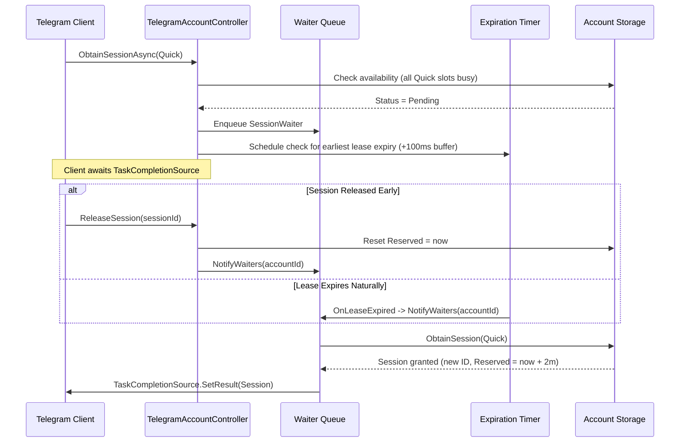
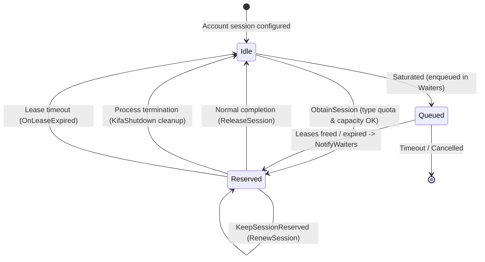

# Telegram Session Leasing and Concurrency Control

## 1. Overview & Problem Statement

Telegram's MTProto protocol enforces strict restrictions on concurrent connections and simultaneous high-bandwidth transfers for user accounts:
- Accounts executing excessive parallel uploads or downloads can be throttled with flood waits (`FLOOD_WAIT_X`) or temporarily banned.
- Interleaving large file transfers with lightweight metadata queries (such as checking file existence, listing channel messages, or deleting files) on the same MTProto connection can cause metadata operations to block or time out.
- In distributed environments or multi-task operations, multiple client processes may attempt to utilize the same underlying Telegram accounts simultaneously.

To resolve these challenges, KifaNet implements a comprehensive **client-server session leasing architecture**:
1. **Server-Side Authoritative Leasing**: The Kifa service manages accounts as shared pooled resources. It enforces strict concurrency quotas per session type, coordinates a FIFO waiter queue with exact-timer wakeups, and authoritative server-dictated lease durations.
2. **Client-Side Deduplication & Keepalive**: Client processes categorize operations into distinct session types, deduplicate concurrent requests per cell via reference counting and asynchronous task coordination, and periodically renew active leases while automatically releasing them upon task completion or process shutdown.

---

## 2. Session Data Model & Types

### Data Models
The session leasing state is stored within the [`TelegramAccount`](file:///Users/kimi/Projects/KifaNet/src/Kifa.Cloud.Telegram/TelegramAccount.cs) and [`TelegramSession`](file:///Users/kimi/Projects/KifaNet/src/Kifa.Cloud.Telegram/TelegramSession.cs) entities:

```csharp
public class TelegramAccount : DataModel, WithModelId<TelegramAccount> {
    public List<TelegramSession> Sessions { get; set; } = new();

    public static int MaxUploadSessions { get; set; } = 2;
    public static int MaxDownloadSessions { get; set; } = 2;
    public static int MaxQuickSessions { get; set; } = 5;

    public static int GetSessionLimit(TelegramSessionType type) => ...;
}

public class TelegramSession {
    public int Id { get; set; }
    public byte[] Data { get; set; }
    public DateTimeOffset Reserved { get; set; } = Date.Zero;
    public DateTimeOffset Refreshed { get; set; } = Date.Zero;
    public TelegramSessionType? Type { get; set; }
}
```

> [!NOTE]
> Session limits (`MaxUploadSessions`, `MaxDownloadSessions`, `MaxQuickSessions`) are configured as static properties on [`TelegramAccount`](file:///Users/kimi/Projects/KifaNet/src/Kifa.Cloud.Telegram/TelegramAccount.cs) (configurable via `KifaConfigs`) rather than instance properties stored on disk or read from individual account JSON documents. When checking active capacity (including upon server reload), the system counts sessions where `Reserved > DateTimeOffset.UtcNow && Type == type`.

### Session Types & Server-Decided Lease Durations
The [`TelegramSessionType`](file:///Users/kimi/Projects/KifaNet/src/Kifa.Cloud.Telegram/TelegramSessionType.cs) specifies the operational role of a session lease:

| Session Type | Purpose | Operations | Default Limit | Lease Duration |
|---|---|---|---|---|
| `Quick` (1) | Fast metadata calls | `List`, `Length`, `Delete`, `GetStatus` | 5 | 2 minutes (`QuickLeaseDuration`) |
| `Upload` (2) | File upload transfers | `Write`, `Upload` | 2 | 10 minutes (`LongLeaseDuration`) |
| `Download` (3) | File download transfers | `Get`, `OpenRead`, `Download` | 2 | 10 minutes (`LongLeaseDuration`) |

> [!NOTE]
> Lease durations are strictly server-authoritative. Clients do not request lease lengths; the server assigns durations based on the requested `TelegramSessionType`.

---

## 3. Server-Side Leasing Logic

The server-side implementation is split between the primary controller and service client in [`TelegramAccountController.cs`](file:///Users/kimi/Projects/KifaNet/src/Kifa.Web.Api/Controllers/TelegramAccountController.cs) and the waiter/timer partial class in [`TelegramAccountController.Waiters.cs`](file:///Users/kimi/Projects/KifaNet/src/Kifa.Web.Api/Controllers/TelegramAccountController.Waiters.cs).

### 1. Synchronous Session Reservation (`ObtainSession`)
When a session is requested via [`ObtainSession`](file:///Users/kimi/Projects/KifaNet/src/Kifa.Web.Api/Controllers/TelegramAccountController.cs#L88-L164):
1. **Account Locking**: Acquires a distributed file lock for the target account via `AcquireLock(accountId)` to guarantee atomicity.
2. **Type Quota Enforcement**: Calculates the active sessions of the requested type (`s.Reserved > now && s.Type == type`). If `count >= GetSessionLimit(type)`, returns `KifaActionStatus.Pending` (`"All {limit} {type} sessions are reserved."`).
3. **Explicit Session Reuse**: If a `sessionId` is specified, checks if the session is currently idle/expired (`Reserved <= now`). If valid, refreshes MTProto credentials if expired, updates `Reserved = now + GetLeaseDuration(type)`, sets `Type = type`, persists to disk, and returns the session.
4. **LRU Allocation**: If type quota allows, filters available idle sessions (`Reserved <= now`) and selects the coldest session (minimum `Reserved`). If no sessions are available, returns `KifaActionStatus.Pending` (`"All {count} sessions are reserved."`).
5. **ID Rotation & Lease Granting**:
   - Generates a new random session ID (`Random.Shared.Next()`) to invalidate any previous stale lease holders.
   - Refreshes session data if MTProto auth has expired (`RefreshIfNeeded`).
   - Sets `Reserved = now + GetLeaseDuration(type)` and assigns `Type = type`.
   - Persists updated account data to disk and returns the granted session.

### 2. Asynchronous Waiter Queue (`ObtainSessionAsync`)
When sessions are saturated, [`ObtainSessionAsync`](file:///Users/kimi/Projects/KifaNet/src/Kifa.Web.Api/Controllers/TelegramAccountController.Waiters.cs#L166-L234) allows callers to await available slots without busy-waiting:
1. **Immediate Check**: Calls `ObtainSession`. If the session is available immediately (`Status != Pending`), it returns instantly with zero asynchronous overhead.
2. **Queueing**: If `Pending` and `WaitTimeout > 0`:
   - Instantiates a [`SessionWaiter`](file:///Users/kimi/Projects/KifaNet/src/Kifa.Web.Api/Controllers/TelegramAccountController.Waiters.cs#L13-L20) with a `TaskCompletionSource<KifaActionResult<TelegramSession>>`.
   - Inserts the waiter into the static `Waiters` collection under `lock (WaitersLock)`.
   - Triggers `NotifyWaiters(accountId)` to re-check slots.
3. **Awaiting & Cancellation**:
   - Waits on the waiter's task with a linked `CancellationToken` and `WaitTimeout` (default 10 minutes).
   - On timeout or cancellation: safely unregisters the waiter from `Waiters`. If the task completed successfully just before cancellation, returns the session; otherwise, marks the task canceled and returns `Pending` or rethrows.
   - **Rollback Safety**: In the finally block, if setting the result fails after allocation (e.g. caller cancelled during notification), [`ReleaseSession`](file:///Users/kimi/Projects/KifaNet/src/Kifa.Web.Api/Controllers/TelegramAccountController.cs#L197-L220) is called automatically to prevent leaked leases.

### 3. Reactive Expiration Engine & Zero-Polling Wakeup
Rather than running a continuous polling loop, the server reacts to state changes and schedules high-precision timers:
- **Notification Triggers**: [`NotifyWaiters(accountId)`](file:///Users/kimi/Projects/KifaNet/src/Kifa.Web.Api/Controllers/TelegramAccountController.Waiters.cs#L100-L160) is triggered on:
  - Explicit session release (`ReleaseSession`).
  - Session lease renewal (`RenewSession`).
  - Session addition (`AddSession`) or modification (`UpdateSession`).
  - Scheduled natural lease expiration (`OnLeaseExpired`).
- **FIFO Processing**: `NotifyWaiters` examines queued waiters in FIFO order. If a waiter cannot be served (e.g., `Upload` limit reached), non-conflicting waiters behind it (e.g., `Quick`) can still be satisfied if their respective limits have capacity.
- **Dynamic Timer Scheduling**:
  - Once active waiters are processed, `GetNextExpiration` computes the earliest `Reserved` timestamp among active sessions blocking remaining waiters.
  - If remaining waiters exist, [`ScheduleExpirationCheck`](file:///Users/kimi/Projects/KifaNet/src/Kifa.Web.Api/Controllers/TelegramAccountController.Waiters.cs#L52-L68) updates a `System.Threading.Timer` targeting `targetTime + ExpirationBuffer (100ms)`.
  - When the timer fires, [`OnLeaseExpired`](file:///Users/kimi/Projects/KifaNet/src/Kifa.Web.Api/Controllers/TelegramAccountController.Waiters.cs#L76-L98) invokes `NotifyWaiters(accountId)`, immediately waking queued waiters the moment a lease expires.
  - If no waiters remain, any active expiration timer is canceled via `CancelExpirationCheck`.



---

## 4. Client-Side Leasing Logic

The client-side storage implementation is handled by [`TelegramStorageClient`](file:///Users/kimi/Projects/KifaNet/src/Kifa.Cloud.Telegram/TelegramStorageClient.cs), [`TelegramStorageCell`](file:///Users/kimi/Projects/KifaNet/src/Kifa.Cloud.Telegram/TelegramStorageCell.cs), and [`TelegramCellClient`](file:///Users/kimi/Projects/KifaNet/src/Kifa.Cloud.Telegram/TelegramCellClient.cs).

### 1. Cell Client Multiplexing & Deduplication
To avoid spinning up redundant MTProto connections for parallel operations, [`TelegramStorageClient`](file:///Users/kimi/Projects/KifaNet/src/Kifa.Cloud.Telegram/TelegramStorageClient.cs#L54-L133) maintains an in-memory cache keyed by `(CellId, Type)`:

```csharp
static readonly Dictionary<(string CellId, TelegramSessionType Type), CellClientEntry> CellClients = new();

class CellClientEntry {
    public int Holders { get; set; }
    public TelegramCellClient? Client { get; set; }
    public TaskCompletionSource<TelegramCellClient>? InitTask { get; set; }
}
```

- **Thread-Safe Acquisition (`ObtainCellClient`)**:
  1. Under `lock (CellClientLock)`, checks if an entry exists for `(CellId, type)`.
  2. If an entry exists and is ready (`Client != null`), increments `Holders` and returns immediately.
  3. If an entry is currently initializing, increments `Holders` and captures `waitTask = InitTask.Task`. Awaits `waitTask` outside the lock.
  4. If no entry exists, creates `tcs = new TaskCompletionSource<TelegramCellClient>()` with `Holders = 1`, stores it in `CellClients`, and creates the client outside the lock.
  5. Upon successful creation, sets `InitTask.SetResult(client)` to unblock all parallel callers. If creation throws, removes the entry from `CellClients` and calls `InitTask.SetException(ex)`.
- **Reference-Counted Release (`ReturnCellClient`)**:
  1. Decrements `Holders` under lock.
  2. When `Holders` drops to 0, removes `(CellId, type)` from `CellClients` and releases the client (`client.Release()`).

### 2. Failure Handling & Storage Cell Failover
In [`TelegramStorageCell.CreateClient`](file:///Users/kimi/Projects/KifaNet/src/Kifa.Cloud.Telegram/TelegramStorageCell.cs#L29-L54):
- Calls `TelegramAccount.Client.ObtainSession(Account.Id, type)`.
- If the server returns a retryable status or `KifaActionFailedException` with `IsRetryable == true`:
  - If status is `Pending`, retries immediately without sleeping because the server already waited for `WaitTimeout`.
  - If non-pending retryable error, sleeps 10 seconds before retrying.
- If the error is non-retryable (e.g. no valid sessions exist on the account), throws [`InsufficientStorageException`](file:///Users/kimi/Projects/KifaNet/src/Kifa/Exceptions/ResourceNotFoundException.cs). In multi-cell / sharded configurations, this exception signals the storage layer to fail over to an alternate cell.

### 3. Background Lease Keepalive & Process Termination
- **Periodic Lease Renewal**: In [`TelegramCellClient.KeepSessionReserved`](file:///Users/kimi/Projects/KifaNet/src/Kifa.Cloud.Telegram/TelegramCellClient.cs#L107-L123), an asynchronous background task periodically invokes `TelegramAccount.Client.RenewSession(Account.Id, sessionId)` at fixed intervals (1 minute for `Quick`, 5 minutes for `Upload` / `Download`) while the client is active.
- **Process Shutdown Hook**: `TelegramCellClient` registers a process cleanup handler via `KifaShutdown.RegisterCleanup(ReleaseAll)`. If a CLI process is terminated (`Ctrl-C`, SIGTERM, normal exit), all active client leases are immediately released via the server's `$release_session` endpoint rather than leaving orphan leases until expiration.

---

## 5. Architectural Summary & Lifecycle States



---

## 6. Key References

| Component | Location | Description |
|---|---|---|
| [`TelegramAccount`](file:///Users/kimi/Projects/KifaNet/src/Kifa.Cloud.Telegram/TelegramAccount.cs) | `src/Kifa.Cloud.Telegram/TelegramAccount.cs` | Data model, static session limits (`MaxUploadSessions`, etc.), RPC client interface |
| [`TelegramSession`](file:///Users/kimi/Projects/KifaNet/src/Kifa.Cloud.Telegram/TelegramSession.cs) | `src/Kifa.Cloud.Telegram/TelegramSession.cs` | Session model with `Reserved`, `Refreshed`, `Type` |
| [`TelegramSessionType`](file:///Users/kimi/Projects/KifaNet/src/Kifa.Cloud.Telegram/TelegramSessionType.cs) | `src/Kifa.Cloud.Telegram/TelegramSessionType.cs` | Enum defining `Quick`, `Upload`, and `Download` session modes |
| [`TelegramStorageCell`](file:///Users/kimi/Projects/KifaNet/src/Kifa.Cloud.Telegram/TelegramStorageCell.cs) | `src/Kifa.Cloud.Telegram/TelegramStorageCell.cs` | Cell client creation, retry handling, `InsufficientStorageException` |
| [`TelegramStorageClient`](file:///Users/kimi/Projects/KifaNet/src/Kifa.Cloud.Telegram/TelegramStorageClient.cs) | `src/Kifa.Cloud.Telegram/TelegramStorageClient.cs` | Cell client caching, reference counting, concurrent `InitTask` await |
| [`TelegramCellClient`](file:///Users/kimi/Projects/KifaNet/src/Kifa.Cloud.Telegram/TelegramCellClient.cs) | `src/Kifa.Cloud.Telegram/TelegramCellClient.cs` | WTelegram client wrapper, background keepalive, shutdown cleanup |
| [`TelegramAccountController`](file:///Users/kimi/Projects/KifaNet/src/Kifa.Web.Api/Controllers/TelegramAccountController.cs) | `src/Kifa.Web.Api/Controllers/TelegramAccountController.cs` | Web API endpoints and core synchronous session allocation / renewal |
| [`TelegramAccountController.Waiters`](file:///Users/kimi/Projects/KifaNet/src/Kifa.Web.Api/Controllers/TelegramAccountController.Waiters.cs) | `src/Kifa.Web.Api/Controllers/TelegramAccountController.Waiters.cs` | Async waiter queue, `GetNextExpiration`, exact `Timer` scheduling |
